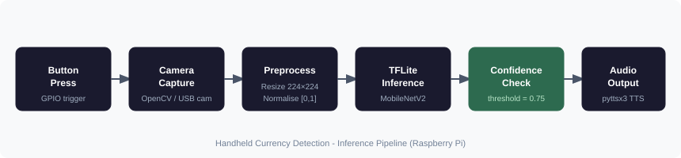

# Handheld Currency Detection Device for the Visually Impaired

## Overview

This was our final year B.E. project at Jyothy Institute of Technology (2024-2025). We wanted to build something that could genuinely help people. The device identifies Indian currency notes and reads the denomination aloud, so visually impaired individuals can use it independently without a smartphone or internet connection.

This project was accepted and published in the IJRASET Journal, Volume 13, Issue V, May 2025. The paper title is “Currency Detection for the Visually Impaired Using Deep Learning". Both the journal certificate and the full published paper are included in this repository.

[Read the published paper on IJRASET](https://www.ijraset.com/best-journal/currency-detection-for-the-visually-impaired-using-deep-learning)


## How It Works

When the user presses the tactile button, the Raspberry Pi captures a frame from the webcam. The image is resized to 224x224 and normalized before being passed to a fine-tuned MobileNetV2 model running as a TFLite interpreter entirely on-device. The class with the highest softmax probability is selected, and the denomination is spoken aloud using pyttsx3.

A confidence threshold of 0.75 is applied (defined as `CONFIDENCE_THRESHOLD` in [raspi.py](raspi.py)). If the model falls below this, the device says "Unable to identify the currency note. Please try again." This was added after testing revealed the model sometimes guessed wrong on crumpled or partially visible notes.

## Model and Architecture



The base model is MobileNetV2 pretrained on ImageNet. The last 30 layers are unfrozen for fine-tuning while the rest are frozen. Training uses data augmentation including rotation, zoom, brightness variation, and small translations to improve robustness in real-world lighting and positioning conditions. After training, the model is exported to TFLite format for deployment on the Pi.

| Property | Details |
| --- | --- |
| Base Model | MobileNetV2 (pretrained on ImageNet) |
| Training Framework | TensorFlow 2.13 / Keras |
| Deployment Format | TensorFlow Lite |
| Input Size | 224x224 pixels |
| Classes | 7 (10, 20, 50, 100, 200, 500 Rupees, Others) |
| Confidence Threshold | 0.75 |

## Hardware

- Raspberry Pi 3B+ or any newer version
- USB Webcam or Pi Camera (minimum 480p)
- Portable Battery Pack (5V, 3A) for untethered use
- Speaker or Headphones for audio output
- Tactile Push Button wired to a GPIO pin

## Software

- Python 3.8 or above
- TensorFlow / Keras for training
- tflite-runtime for on-device inference
- OpenCV
- pyttsx3 for offline text-to-speech
- Pillow

## Dataset Structure

```text
dataset/
├── 10/
├── 20/
├── 50/
├── 100/
├── 200/
├── 500/
└── others/
```

Each folder contains images of that denomination.

## Training

Update the path constants at the top of [trainh5.py](trainh5.py) and run the script. It fine-tunes the model, saves the best checkpoint using ModelCheckpoint, and automatically converts the saved `.h5` file to TFLite format at the end. Training ran for around 40 to 50 epochs before early stopping kicked in on our dataset.

## Deployment on Raspberry Pi

1. Transfer `currency_model.tflite` to the Raspberry Pi.
2. Install dependencies listed in `requirements.txt`.
3. Update `MODEL_PATH` in [raspi.py](raspi.py) to point to the model file.
4. Run `raspi.py` and press the button to trigger a capture and get the audio result.

## Publication

This project was accepted and published in the IJRASET Journal, Volume 13, Issue V, May 2025. The paper title is “Currency Detection for the Visually Impaired Using Deep Learning”. Both the journal certificate and the full published paper are included in this repository.

## Team

| Name | Student ID | Email |
| --- | --- | --- |
| Achal Nanjundamurthy | 1JT21CS003 | [achalnm02@gmail.com](mailto:achalnm02@gmail.com) |
| Aruna A Shenoy | 1JT21CS019 | [aruna.shenoy31@gmail.com](mailto:aruna.shenoy31@gmail.com) |
| Bhushan M V | 1JT21CS030 | [bhushanmv2003@gmail.com](mailto:bhushanmv2003@gmail.com) |
| Pujitha D R | 1JT21CS128 | [pujitharamesh2712@gmail.com](mailto:pujitharamesh2712@gmail.com) |
